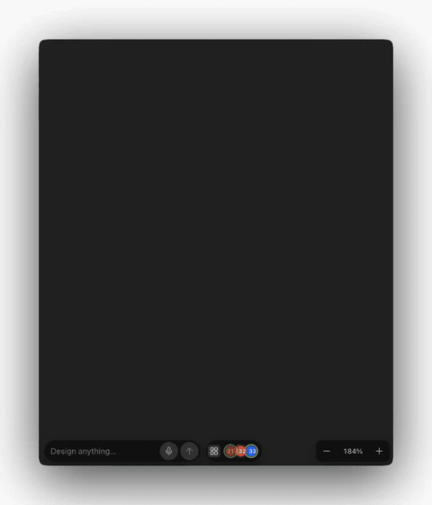
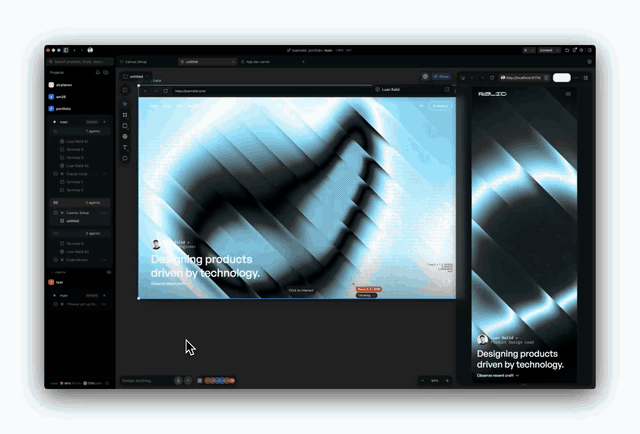
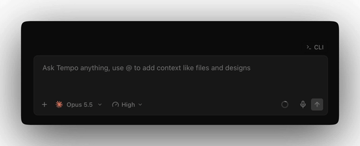

# RE-TEMPO

Your own Tempo, plus a layer of UI mods: agents on the canvas, voice input, plan usage, a freer layout.

It builds locally from the Tempo you already have. This repo holds no Tempo code, only the mods and the scripts that apply them. RE-TEMPO runs as a separate app with its own profile; your Tempo app, account and data stay as they are.

## Install

You need a Mac with Apple Silicon (macOS 12+) and Tempo in `/Applications`, ideally 0.0.121 (other versions install with a warning). About 1 GB of disk. Nothing else.

1. Clone the repo, or download it as a zip.
2. Double-click `Install RE-TEMPO.command`, or run `./install.sh`. About a minute.
3. RE-TEMPO opens logged out. Log in with your Tempo account.

Open it later with `~/RE-TEMPO/RE-TEMPO.command`, not `RE-TEMPO.app` (that one uses your normal Tempo profile).

Uninstall: quit RE-TEMPO, move `~/RE-TEMPO` to the Trash.

## What's in it

**Agents on the canvas.** Leave a comment. An agent picks it up, shows its cursor and current step, and replies in the thread.

<a href="media/agent-on-canvas.mp4"></a>

**Deploy from the canvas.** Type a request in the canvas bar. A new agent joins the stack and works next to the others.

<a href="media/deploy-agent.mp4"></a>

**Voice input.** Talk into the composer. Words land as you speak, transcribed on-device (macOS 26+).

<a href="media/voice-input.mp4"></a>

**Plan usage.** Claude and Codex limits in the sidebar footer. Hover for details, click to refresh.

<a href="media/plan-usage.mp4"></a>

Plus about 30 more: free pane layout, a pen.dev-style canvas, browser and shader frames on the canvas, Figma-style shortcuts, a project sidebar. Every change vs stock Tempo is listed in [docs/changes](docs/changes/README.md).

## How it works

`install.sh` clones your `Tempo.app` (APFS clone, nearly free), unpacks it, renames it, turns off auto-update and re-signs it ad hoc. Then it loads `feature/` into the renderer through `index.html`. Mods are plain JS and CSS on top of Tempo's UI; no Tempo bundle is edited. RE-TEMPO keeps its own profile and ports in `~/RE-TEMPO`, so both apps run at once. Nothing is downloaded or uploaded.

Run `./install.sh` again to update the mods, and `./install.sh --rebuild` after Tempo updates itself. Also: `--no-open`, `RE_TEMPO_BASE=<dir>`, `TEMPO_APP=<path>`.

## Troubleshooting

- **macOS blocks the `.command`:** right-click > Open > Open, or `xattr -dr com.apple.quarantine <folder>`.
- **"the mods were made for 0.0.121":** Tempo updated. Most mods keep working; run `./install.sh --rebuild`.
- **"RunAsNode fuse is off":** install Node 18+ and run again.
- **You see your normal Tempo account:** you opened `RE-TEMPO.app` directly. Use `RE-TEMPO.command`.
- **Anything else:** run the installer again. Replaced files go to `~/RE-TEMPO/_backup/`; the log is `~/RE-TEMPO/_app.log`.

Short version for testers: [TESTING.md](TESTING.md).

## Develop

```sh
./install.sh --dev           # mods load from feature/ through a symlink
tools/start-live.sh          # DevTools on 9333; CSS hot-swaps, JS reloads on save
scripts/package-release.sh   # dist/re-tempo-<version>.zip, this repo's files only
cd qa && npm install && node run.mjs --suite 00-smoke --instances 3   # isolated QA over CDP
```

## Layout

Each folder has a short README.

- [feature/](feature/README.md): the mods.
- [scripts/](scripts/README.md): what the installer runs.
- [tools/](tools/README.md): the live-editing loop.
- [qa/](qa/README.md): automated tests.
- `docs/`: [index](docs/README.md). Start with [mods.md](docs/mods.md), [modding-guide.md](docs/modding-guide.md) and [reverse-engineering.md](docs/reverse-engineering.md) (Electron 42, React 19, Convex, 403 IPC channels).

## Not included

Tempo itself: no source, bundles, binaries or bundled CLIs. `.gitignore` blocks them. Bring your own licensed copy. Local use only.
